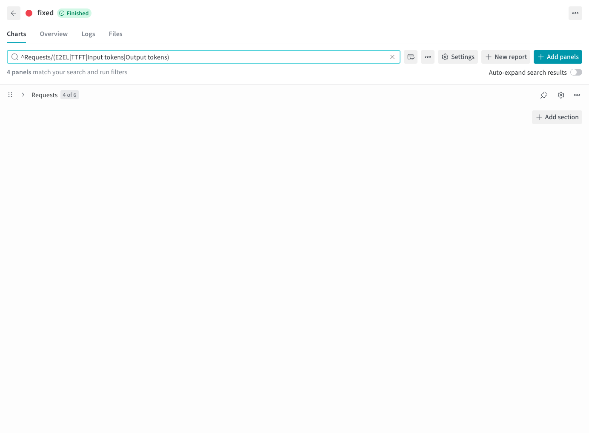

# W&B 输出

[English](wandb.md) | 简体中文 · [性能评测示例](README_zh.md)

完成[准备步骤](README_zh.md#准备)后，指定项目、分组和运行名称：

```bash
foretoken perf examples/quickstart/qwen3-0.6b \
  --num-prompts 20 --output local,wandb \
  --wandb-project foretoken-bench \
  --wandb-group qwen-comparison \
  --wandb-run-name quickstart
```

终端会打印结果目录；在线上传时，还会打印 `wandb-sync.log` 的位置，quiet 模式也保留这些信息。日志包含运行链接、上传进度和失败后的恢复命令，测量命令退出后上传仍会继续。`--wandb-entity` 选择账号或团队。需要对比的运行使用相同的 `--wandb-group`，在该分组的 Workspace 中查看。扫描和多数据集运行在未指定 group 时自动分组，单次评测默认不分组。

## 查看进度与比较结果

用逐请求曲线检查单次请求，用累计曲线观察整体进度，用一秒完成窗口比较吞吐量及 P50/P95/P99 延迟随时间的变化。HTTP 正式测量期间会持续更新这些视图；窗口可能需要等待较早发出的请求结束。测量结束后展示最终汇总指标，Summary 保留最终值。



混合负载可按数据集、模型和请求类别查看细分结果。Kustomize 评测还提供副本数和 GPU 分配量观测；服务具备 Prometheus 时，可查看资源使用和猜测解码指标。定义、单位和观测覆盖范围见[性能指标](../metrics_zh.md)。

## 下载记录

在运行页面的 Artifacts 中下载配置、指标、请求记录和日志。扫描或对比任务的共享服务准备、清理日志保存在父运行中。各类文件的用途和输出选项见[结果设置](../../README_zh.md#查看和保存结果)。

预热不计入性能指标，也不占用面板，记录保存在 `benchmark-warmup` 附件中。在 `--output local,wandb` 中加上 `plot`，即可将导出的图表保存在本地和 `benchmark-plots` 附件中。

## 恢复上传

评测时选择了 W&B 输出，需要补传已有结果时，将终端打印的结果目录传给：

```bash
foretoken plot RESULT_DIR --sync_wandb
```

命令会重绘图表并更新原来的 W&B 运行，不重新测量；中断运行也可上传已有记录。单次运行的图表随结果上传，跨运行对比图保留在本地。绘图失败时仍会尝试上传，并报告绘图错误。

离线评测时设置 `WANDB_MODE=offline`，并在 `--output` 中保留 `wandb`；需要上传时执行上述命令。

换一台机器上传时，复制完整结果目录树，包括隐藏文件。续跑实验引用的旧任务目录也需一并复制，保留目录之间的相对位置。在目标机器安装 Foretoken、执行 `wandb login` 后，即可运行上述命令。使用自托管 W&B 时，先通过 `WANDB_BASE_URL` 指定服务器，再登录。
