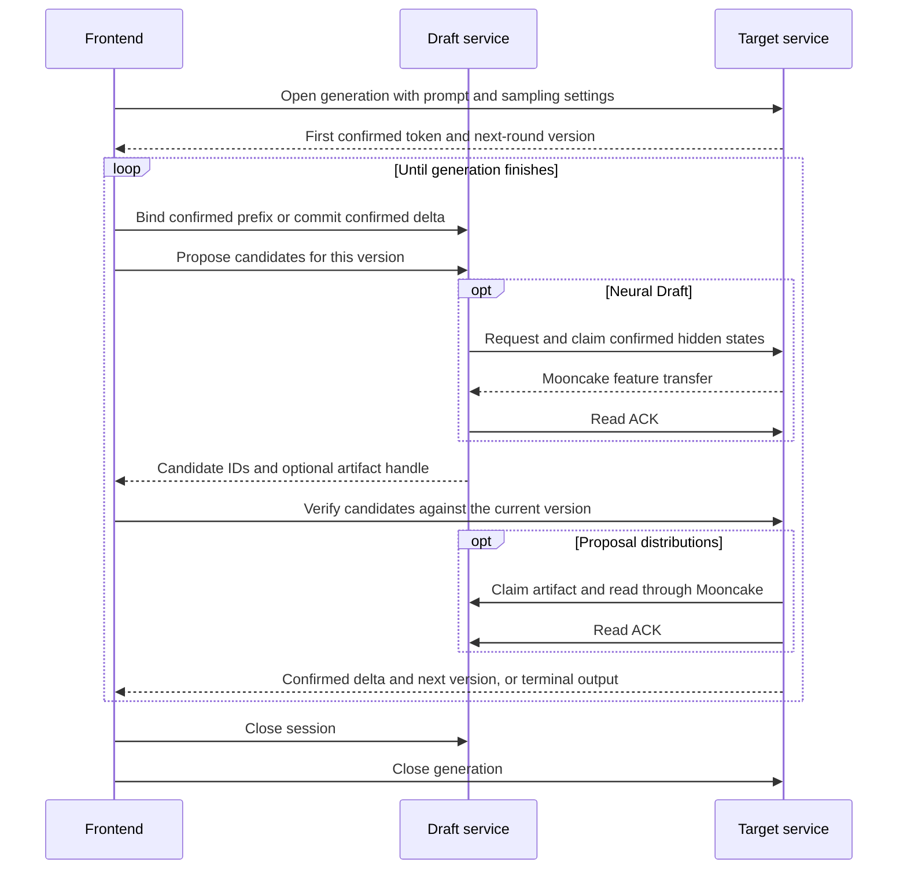

<!--
SPDX-License-Identifier: Apache-2.0
SPDX-FileCopyrightText: Copyright contributors to the Foretoken project
-->

# [RFC] Draft/Target disaggregation for speculative decoding

Status: proposed for review. Implementation: [PR #199](https://github.com/shiweijiezero/foretoken/pull/199).

## Motivation and scope

Speculative decoding uses a Draft model to propose tokens and a Target model to
verify them. Only Target confirms output. Accepting several candidates can advance
generation by several tokens in one verification pass, but running both models in
one engine couples their placement, memory and compute allocation.

Foretoken separates Draft and Target into independently provisioned services while
retaining its existing public generation APIs. Each pool can have multiple
instances. The frontend schedules inference rounds and routes them to compatible
workers; each engine retains local batching and KV ownership. This boundary also
supports experiments with proposal length, scheduling, placement and Draft methods
without putting cluster policy inside the inference engine.

The implementation has two parts: an independently runnable vLLM plugin providing
the role services, and Foretoken integration for deployment, discovery, routing,
request scheduling and output processing. Independent autoregressive Draft models
are supported on NVIDIA and MetaX. Target hidden states support neural Draft
adapters on NVIDIA. Target KV migration is available under narrower conditions,
through a caller-selected operation between rounds.

Independent deployment does not establish a speedup. Communication, repeated
Draft work and coordination must be measured against the Target work saved.

## The basic DT architecture in Foretoken

### Deployment and responsibility

Aggregate, Prefill and Decode describe execution stages. Draft and Target describe
responsibilities in speculative decoding. DT currently uses Aggregate pools: each
role performs its own prefill and decode, even when its model participates in a
larger speculative workflow.

`ModelService.spec.model` identifies the public Target model.
`spec.speculation.draftPool` refers to one Aggregate pool whose `model` supplies the
Draft weights. Other Aggregate pools use the service model as Target. Pool replica
counts and resources remain independently configurable. The controller derives
the internal speculation responsibility; there is no public `target` deployment
role. The [maintained deployment example](../../examples/draft-target/README.md)
owns the runnable configuration.

Multiple Draft instances currently mean replicas within that model configuration,
not automatic selection among different Draft models or a cascade of verifiers.
Each inference round uses one Draft and one Target for each request. Both roles
must use the same tokenizer identity and candidate token-ID meanings. Proposal
distributions use the Target vocabulary; a neural adapter may map its internal
reduced vocabulary into that space. Translation between tokenizers is not implemented.

| Component | Responsibility |
| --- | --- |
| Controller | Pool capacity, rollout, model preparation and serving snapshots |
| Router | Compatible worker selection through Filter–Scorer–Picker |
| Frontend DT scheduler | Ready queues, grouping requests into rounds and dispatching their results |
| Frontend request state and round executor | Confirmed prefix, remote sessions, proposal/verification order and cancellation |
| Draft service | Candidate generation from confirmed context |
| Target service | Persistent generation, candidate admission, verification and final commitment |
| Each vLLM scheduler | Local execution batches, KV allocation and preemption |
| Worker and DT Connector | Tensor production, transfer, consumption and memory lifetime |

The controller changes capacity; it does not advance inference rounds. Frontend
batching controls which requests are submitted together. vLLM independently
constructs its execution batches from local token budgets, sequence limits and KV
capacity.

### One request and one inference round

Target first receives the prompt and sampling settings. Its prefill produces the
first confirmed token without Draft. The frontend retains the prompt plus that
token as the confirmed prefix and opens a Draft session.

Draft proposes candidates, for example `[a,b,c]`. If Target accepts `a`, rejects
`b` and produces correction token `x`, only `[a,x]` extends the confirmed prefix.
The next proposal uses that prefix; rejected or unchecked candidates do not become
context. When all candidates are accepted, Target may also produce a bonus token,
subject to stopping and length limits.

Clients receive only Target-confirmed output. The frontend uses exact token IDs
for subsequent Draft context rather than re-tokenizing displayed text: stop-string
processing can crop text at boundaries that differ from token boundaries.

An independent Draft uses an ordinary vLLM request for each proposal. Constructing
that request from confirmed tokens excludes rejected guesses. Native automatic
prefix caching can reuse computed Draft blocks; no separate Draft KV rollback
implementation is needed. Request setup and partial-prefix recomputation remain
potential costs. Draft KV and Target KV are distinct: different model weights do
not produce interchangeable cached state.

### Waiting, tickets and admission

A Target waiting for Draft still owns a generation session and may hold KV pages,
but has no verification work ready. The engine adapter marks this state in the
native scheduler, allowing unrelated requests to execute and allowing native KV
preemption. EngineCore sleeps when only remote waiters remain.

Each nonterminal output supplies a ticket comprising the native internal request
ID and the cumulative confirmed-output count. The role exposes its generation as
`version`. A proposal is admitted only if the request is alive, waiting and still
at that generation. Admission consumes that waiting state, so duplicate or stale
submissions cannot schedule the same round twice. Admission is not token acceptance;
Target output determines the confirmed result.

Preemption clears the old waiting state before releasing KV and replaying native
request state. Replay must advance the output frontier before another ticket is
used. The frontend does not apply an old proposal to a new generation.

## What is reused and what is adapted

### Native inference execution

The plugin uses native vLLM execution and sampling, with the engine-specific
boundary in `foretoken_dt.vllm`. NVIDIA targets
`vllm==0.30.1rc1.dev194+g3b4566c5c`; MetaX targets the repository's source pair
`vllm==0.30.0.dev0` and `vllm-metax==0.29.0.dev0`. These are the implementation's
supported versions, not a claim of compatibility with arbitrary newer engines.

| Native facility | DT adaptation |
| --- | --- |
| AsyncLLM output, stopping and abort | Retain internal request identity and attach nonterminal tickets |
| EngineCore utility queue and lifecycle | Submit external candidate batches and expose scheduler observations |
| Scheduler batching, KV allocation and preemption | Distinguish remote waiting from executable work and validate tickets |
| Worker and ModelRunner v2 (MRV2) | Fill external candidate state for the current request slots before input preparation |
| Native rejection sampler | Consume the actual Draft proposal distributions |
| Native Draft speculators and model loaders | Consume transferred Target features and load the required shared weights |
| Worker extension and registered tensors | Export, claim, read, stage and release DT artifacts |

The package uses class-selection interfaces and scoped process-local hooks; it
does not edit installed vLLM source or copy the native scheduling algorithm.
Internal hooks remain version-sensitive. MRV2 sits below EngineCore, Executor and
Worker; it does not replace them. Updating CPU candidate lists alone is insufficient
because MRV2 input preparation reads GPU request-slot state.

Target loads no local Draft model. Independent Draft execution exports the
processed distribution from its actual sampling path. Neural Draft execution
reuses the supported native speculator. Details belong to the
[engine integration contract](../../data-plane/dt-plugin/docs/mrv2-integration.md).

MetaX integration preserves the platform-selected Worker and uses the existing
MACA runtime and Mooncake build. Batch-invariant execution defaults to `1` on
NVIDIA and `0` on MetaX, preserving an explicit environment setting. Numerical
settings must match in Target-only comparisons; successful random generation does
not prove distribution equivalence or GPU-direct transfer.

### Foretoken services and lifecycle

DT reuses ModelService and pool reconciliation, model preparation, RuntimeCache,
serving snapshots, registry probes, Router selection, public request normalization
and output processing. The model-server uses its existing process supervisor and
drain deadline to run the installed role application. Runtime and model-server
images retain their existing build ownership.

The serving snapshot keeps the public Target identity in `models` and ready role
instances in `dt_components`, with loaded engine identity recorded separately.
Loading a prepared filesystem snapshot must preserve the configured discovery
identity. Registry probes check health, role, model/tokenizer identity, format and
admission state. The workflow checks live pair compatibility before binding,
including matching neural `context_profile` values when present.

Public request validation occurs after generation defaults are resolved. The DT
path supports temperature, top-p, top-k, Target seed and normalized stopping/length
settings. It rejects unsupported penalties, min-p, logprobs, structured output,
multimodal input and other unsupported engine options before role admission.
The [frontend contract](../../data-plane/dt-plugin/docs/frontend-workflow.md#normalized-request-semantics)
owns the complete list.

## Tensor transfer and neural Drafts

### Proposal distributions

Greedy verification can use candidate token IDs. Stochastic rejection sampling
also needs the distribution `q` that Draft actually sampled: acceptance uses its
ratio with Target distribution `p`, and rejection uses a residual distribution
proportional to `max(p-q,0)`. The selected token's probability alone is insufficient.

Draft exports full normalized float32 `log(q)` rows of shape
`[candidate_count, vocabulary_size]`, after Draft temperature and supported
truncation. The frontend relays candidate IDs and artifact handles. Target claims
the artifact directly from Draft to obtain its GPU descriptor, then reads the
tensor through Mooncake. The frontend neither copies probability arrays nor
handles GPU addresses.

The adapter supplies the received distribution to native rejection sampling with
the required temperature scaling. Draft draws remain independent of Target's RNG;
a Target seed does not guarantee the same sequence across proposal schedules.
Without RDMA both roles advertise `greedy_token_ids` and accept temperature zero
only. RDMA roles advertise `token_ids_log_probs`; selected peers must agree.

### Target hidden states and Draft model adapters

Some Draft methods depend on Target features as well as confirmed token IDs.
Target retains final and auxiliary hidden states indexed by token position. At a
paused generation ticket it exports the confirmed computed prefix, excluding the
last correction or bonus token, which serves as the next proposal's anchor.
Rejected suffixes are excluded from that history.

Draft obtains these features from the current Target session through the same
artifact claim/read/ACK lifecycle. The feature tensor has shape
`[computed_tokens, feature_layers, hidden_size]` in the Target's dtype. Draft checks
its profile and confirmed prefix before admitting local work. The adapter keeps
the Target backbone on the meta device, materializes required shared
embedding/output weights, and supplies received features to the native Draft
speculator. The Draft GPU does not load the full Target backbone.

Enabled NVIDIA adapters cover DFlashDraftModel, Qwen3DSparkModel, EAGLE/EAGLE3 and
single-module MTP with an unquantized text Target. DSpark reuses native Markov
sampling and vocabulary mapping, exporting the conditional distributions actually
used for its linear proposal. Confidence-based adaptive verification is not enabled.
The [neural Draft guide](../../data-plane/dt-plugin/README.md#run-a-neural-draft-pair-on-nvidia)
owns model and launch details.

Target prefix caching is disabled for this path because cached KV alone cannot
provide the skipped hidden states. DFlash and DSpark retain local Draft prefix
caching. EAGLE/MTP Draft KV also depends on the next token, potentially outside a
cached page's token hash, so those adapters disable Draft prefix caching.
Every proposal currently transfers the full computed feature prefix, even when
Draft reuses cached pages. Incremental feature transfer is an optimization to
investigate, not an implemented capability.

### Artifact ownership

The Worker fences producer writes before publication. Claim and cancellation are
serialized: an unclaimed artifact can be revoked; a claimed publication remains
registered and immutable until the receiver acknowledges its exact publication.
The receiver admits inference only after the read completes and retains its local
copy through model consumption.

Read ACK, inference admission and model completion are separate events. Cancelling
HTTP does not cancel DMA. The claim/read/ACK task retains transport ownership after
caller cancellation, while invalidated tickets prevent stale inference. Uncertain
transfers or a lost peer can retain buffers until process termination; there is no
transparent peer-failure recovery.

Reusable registrations remain in Worker-owned pools. Feature buffers use geometric
row capacities; other tensors use exact shapes. Memory may remain at prior
concurrency peaks after active sessions reach zero. Drain therefore observes both
sessions and retained artifacts. The [Connector contract](../../data-plane/dt-plugin/docs/connector-contract.md)
owns these lifetime rules for proposal distributions, features and KV checkpoints.

## Multiple instances: scheduling, routing and Target migration

### Per-round scheduling and batching

Each public model has a ready queue. The scheduler immediately groups available
requests by required Target, sampling mode and placement constraints; it does not
wait for a fixed batch size. Router selects Target then Draft using the existing
Filter–Scorer–Picker pipeline. Compatibility applies to every member, while the
first member supplies the batch placement preference.

A fresh request receives Target prefill output. A continuation generates its next
proposal and joins a batch verification submission. Target prepares the member
artifacts and admits valid tickets in one EngineCore utility call. Native capacity
limits still determine whether those requests execute in one or several vLLM batches.

Results return independently. A scheduler must advance ready continuations while
other prefills remain queued: waiting for every original member can deadlock when
vLLM's sequence limit prevents the remaining prefills from starting. Requests from
different earlier batches can join a later round. Backpressure, deadlines and
cancellation apply per request, so a slow client pauses its own continuation.

Draft is selected again each round. The same Draft receives a confirmed delta; a
new Draft receives the full confirmed prefix. Ordinary rounds retain the request's
current Target session and KV location. Round reservations account for selected
work until each member returns; they do not represent lifetime session count or
KV occupancy.

Native ready, waiting, remote-waiting and KV observations reach Router through
BackendRegistry's existing telemetry path. Prometheus is for observation, not a
routing dependency. Prefix-hit prediction has no KV-index source in this path.
No SLO batching policy, migration cost estimator or DT-specific autoscaling policy
is implemented.

### Target KV migration between rounds

The request-state API exposes `migrate_target` for a caller-selected destination.
The public scheduler does not invoke it automatically. Source and destination
must both enable migration and have matching model/revision/tokenizer identity
and compatible full-attention KV layouts. The current path requires NVIDIA,
RDMA, one GPU per role and greedy sampling; neural Target features are not included.

The source copies resident confirmed KV into a checkpoint artifact. The destination
claims and reads it, uses its native scheduler to allocate pages, loads the received
KV before attention, and computes only the uncomputed suffix. Local prefix-cache
hits can be reused. The frontend updates the request's Target location and closes
the old Target and Draft bindings after the first destination output proves that
generation continued.

The source session remains owned until that point. Errors or cancellation close
both sessions and terminate the request; there is no retry or rollback. If native
preemption has removed the source KV, export fails rather than presenting prefix
recomputation as migration. Transfer ownership follows the same claim/read/ACK
rules as other artifacts. See the [migration API](../../data-plane/dt-plugin/docs/frontend-workflow.md#move-a-request-between-targets).

### Drain and serving updates

Drain refuses new bindings while allowing existing sessions to finish. An explicit
admission refusal returns unchanged request state for new placement; network or
inference failures are not retried. Bound Target sessions can finish on their
current draining owner. Readiness remains available so Kubernetes preserves the
network path for those sessions.

Each runtime generation owns its queues and worker inventory. On a serving update,
queued requests without a Target session return to the HTTP owner for preparation
against the new runtime, preserving their deadline and cancellation. Requests
with live Target sessions retain their original inventory, which continues
refreshing observations until those responses close. Invalid snapshot updates
leave the active generation intact.

Dropping request state closes its sessions; terminal output releases them before
being yielded. An EOF without a terminal commit is a failure. During shutdown the
model-server waits for sessions and retained artifacts, then signals the role
launcher so it can release Worker transport resources before stopping EngineCore.
The existing bounded process-group teardown remains the fallback.

## Optimization and experiment design

The round API separates request state, placement and execution so experiments can
change a policy while keeping token commitment and resource ownership unchanged.
The following are experiment directions, not performance claims or enabled policies.

| Direction | Controllable change | Measurements and trade-offs |
| --- | --- | --- |
| Scheduling and batching | Queue order, grouping, bounded batch wait and submission timing | TTFT/TPOT, queue delay, native batch sizes and throughput; larger batches may add waiting |
| Routing and capacity allocation | Draft/Target scoring, replica ratios and placement | Load balance, remote wait, KV pressure and achieved throughput at a fixed total GPU budget |
| Proposal length | Candidate budget by context or workload | Accepted/verified candidates, committed tokens per round, Draft work and verification cost |
| Draft method and model | Independent Draft versus supported feature-based adapters | Quality, acceptance, Draft memory/compute and Target feature retention cost |
| Feature and probability transport | Incremental features, buffer reuse and transfer overlap | Actual bytes/read time, repeated prefix cost, registered memory and model readiness |
| Target migration | Caller policy for waiting versus moving at a round boundary | Export/read/resume cost, source residency, queue savings and request latency |
| Engine execution | Supported local batch and memory settings | Native scheduling, preemption and GPU execution time under matched numerical settings |

Frontend observations identify the round, selected workers, proposed/verified/
accepted/committed tokens and stage durations. Engine observations distinguish
executable work from waiting for remote input. Migration records include checkpoint
size and export/read timings. Aggregate metrics keep request and worker identities
out of labels; detailed identities remain in traces and returned round records.
The [measurement contract](../../data-plane/dt-plugin/docs/role-protocol.md#observations)
defines each interval: several overlap, and schedule-to-result wall time is not
GPU kernel time. Do not sum overlapping durations or substitute these records for
end-to-end latency distributions.

Start with matched Target-only and DT workloads, public APIs, numerical settings
and total GPU budgets. Compare correctness and quality before throughput and SLO
results. Separate model execution, queueing and transfer effects, including the
overhead of observation RPCs. For the sequential dependency within one request,
the useful first approximation is total round time divided by mean confirmed
tokens per round. Independent GPUs do not by themselves overlap dependent rounds.

## Supported boundary and validation

The adapter handles text and linear candidates with one eager GPU worker per
instance, synchronous local scheduling and output interval one. Trees, cascaded
verification, multimodal input, P/D composition, KV offload and transparent
recovery after worker failure are outside this implementation. Neural Drafts have
the method and architecture limits documented above; MetaX neural drafting and
Target migration with hidden states are not enabled.

Validation must distinguish standalone roles, frontend orchestration and packaged
Kubernetes execution. Greedy comparisons need matched numerical settings. Random
request completion checks execution and cleanup, not statistical equivalence.
A tensor diagnostic does not establish correctness of the model chain, GPU-direct
transfer or a performance benefit.

Historical NVIDIA runs exercised cross-host proposal transfer, public streaming
and Kubernetes DT → Aggregate → DT rollout. Historical MetaX runs exercised
standalone and supervised public generation and ordered shutdown. A subsequent
two-Draft/two-Target NVIDIA run exercised mixed concurrent requests, greedy
comparison, cancellation, runtime snapshot updates, drain and caller-selected KV
migration. That multi-instance run used one host with two GPUs and preceded the
hidden-state adapters; it does not validate their behavior or cross-node migration.
Separate same-host A100 runs exercised DFlash, EAGLE3, Qwen3 DSpark and MiMo MTP
with RDMA, including greedy comparisons, longer prefixes, Draft rebinding, random
generation and cancellation. They do not establish cross-host neural execution or
current-image Kubernetes acceptance.

These results cover specific tested revisions and configurations, not every
combination in the current implementation. Current-revision checks and their
artifacts belong in the PR validation record. Full cross-node Kubernetes/RDMA
lifecycle, scaling under active traffic, stochastic distribution-equivalence and
performance/SLO benefit remain separate acceptance work. This RFC makes no speedup
claim.

## Implementation references

- [Standalone role launch and supported Draft methods](../../data-plane/dt-plugin/README.md).
- [Role protocol and observations](../../data-plane/dt-plugin/docs/role-protocol.md).
- [Connector memory ownership](../../data-plane/dt-plugin/docs/connector-contract.md).
- [Native engine integration](../../data-plane/dt-plugin/docs/mrv2-integration.md).
- [Frontend round API and runtime lifecycle](../../data-plane/dt-plugin/docs/frontend-workflow.md).
- [Kubernetes deployment](../../examples/draft-target/README.md).
